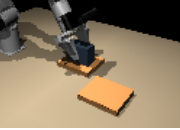
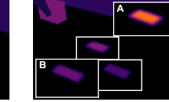
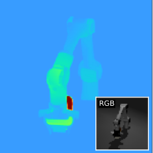
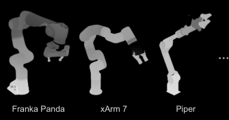
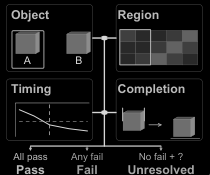
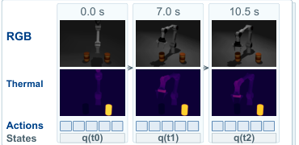
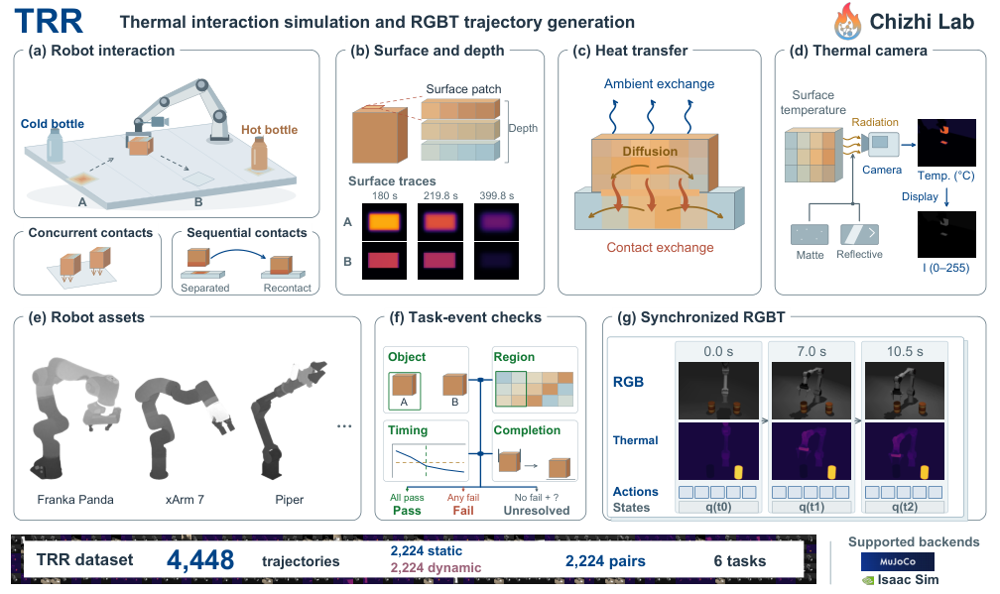

<div class="hero">
  <div class="hero-copy">
    <p class="eyebrow">THERMAL INTERACTION ENGINE</p>
    <h1>TRR</h1>
    <p class="hero-statement">Every contact leaves a temperature memory for the next one.</p>
    <p class="hero-meta">Thermal Interaction Engine · MuJoCo + Isaac Sim · 4,448 trajectories</p>
    <div class="hero-actions">
      <a class="button-primary" href="#capabilities">Explore the engine</a>
      <a class="button-secondary" href="https://arxiv.org/html/2611.20792v1">Read the preprint</a>
    </div>
  </div>

  <div class="hero-media">
    
    <div class="residual-callout"><span>Residual heat<br>from previous contact</span></div>
  </div>
  <p class="hero-caption">A robot waits, transfers a hot object and reveals the heat left by earlier contacts. <span>Accelerated playback · simulation time shown on screen</span></p>

  <div class="hero-affiliation">
    
    
    <span>Chizhi Lab · Beijing Institute of Technology</span>
  </div>
  <nav class="hero-nav" aria-label="Page sections">
    <a href="#capabilities">Capabilities</a>
    <a href="#technology">Technology</a>
    <a href="#evidence">Evidence</a>
    <a href="#resources">Resources</a>
  </nav>
</div>

<div class="stats-grid" aria-label="TRR scale">
  <div class="stat"><span class="stat-number">4,448</span><span class="stat-label">trajectories</span></div>
  <div class="stat"><span class="stat-number">2,224</span><span class="stat-label">condition pairs</span></div>
  <div class="stat"><span class="stat-number">6</span><span class="stat-label">tasks</span></div>
  <div class="stat"><span class="stat-number">2</span><span class="stat-label">backends</span></div>
</div>

## From one contact to the next

<p class="lead">Contact leaves heat behind. TRR carries that history into the next interaction.</p>

Earlier actions change the temperature of the object, gripper and supports. After the object leaves, those traces remain; subsequent contacts encounter the accumulated thermal history rather than a reset scene.

<figure class="figure feature-figure">
  
  <figcaption><strong>The boxed insets A and B are the evidence:</strong> residual heat from earlier contacts remains visible in the final thermal frames.</figcaption>
</figure>

## What TRR does
{: #capabilities}

<div class="capability-grid">
  <div class="capability-card">
    <span class="card-index">01</span>
    <h3>Persistent thermal memory</h3>
    <p>Contact traces stay on objects and grippers after separation.</p>
    <p class="card-detail">Surface patterns and internal heat storage move with the material.</p>
  </div>
  <div class="capability-card">
    <span class="card-index">02</span>
    <h3>Contact-driven evolution</h3>
    <p>Every contact can change what happens next.</p>
    <p class="card-detail">Heating, cooling, transfer, separation and recontact evolve within one execution.</p>
  </div>
  <div class="capability-card">
    <span class="card-index">03</span>
    <h3>Task-grounded observations</h3>
    <p>RGBT data stay synchronized with robot states, actions and outcomes.</p>
    <p class="card-detail">Task checks produce pass, fail or unresolved records.</p>
  </div>
</div>

## Technology, in thermal signals
{: #technology}

<div class="module-grid">
  <div class="module-card">
    
    <div class="module-copy"><h3>Robot interaction</h3><p>Concurrent contacts, separation and recontact share one evolving scene.</p></div>
  </div>
  <div class="module-card">
    
    <div class="module-copy"><h3>Thermal storage</h3><p>Surface traces and internal heat move with the object.</p></div>
  </div>
  <div class="module-card">
    
    <div class="module-copy"><h3>Heat transfer</h3><p>Heat enters at contact, diffuses through material and remains after separation.</p></div>
  </div>
  <div class="module-card">
    
    <div class="module-copy"><h3>Thermal camera</h3><p>It sees surface temperature, not color.</p><p class="card-detail">Matte / Reflective responses · °C and 8-bit display output</p></div>
  </div>
  <div class="module-card">
    
    <div class="module-copy"><h3>Robot assets</h3><p>Franka Panda, xArm 7 and Piper interact with the same thermal state.</p></div>
  </div>
  <div class="module-card">
    
    <div class="module-copy"><h3>Task-event checks</h3><p>Object, region, timing and completion checks ground each outcome.</p><p class="card-detail">Pass · Fail · Unresolved</p></div>
  </div>
  <div class="module-card">
    
    <div class="module-copy"><h3>Synchronized RGBT</h3><p>RGB, thermal images, timestamped actions and robot states stay aligned.</p></div>
  </div>
</div>

<details class="technical-details">
  <summary>View the full technical diagram</summary>
  
</details>

## One thermal state, two simulation backends

<figure class="figure backend-figure">
  
  <figcaption><strong>MuJoCo · Piper</strong> and <strong>Isaac Sim · Franka</strong>, with RGB insets. Temperature images share a display scale; gray regions have unavailable samples. Dynamic interaction and learning studies use MuJoCo-based workflows.</figcaption>
</figure>

## From scene to synchronized data

<ol class="workflow">
  <li><span>01</span><div><strong>Build the scene</strong><p>Geometry, objects, supports, robot motion and camera placement.</p></div></li>
  <li><span>02</span><div><strong>Configure the thermal state</strong><p>Materials, initial fields, contact parameters and camera response.</p></div></li>
  <li><span>03</span><div><strong>Run the interaction</strong><p>Thermal evolution and robot motion advance together.</p></div></li>
  <li><span>04</span><div><strong>Inspect and export</strong><p>Synchronized observations, states, action intervals and task events.</p></div></li>
</ol>

<p class="engineering-note">Engineering inventory: 10 robot configurations · 16 thermal-cache categories · 6 demonstrated camera viewpoints. LeRobot and robomimic formats have small-batch loading checks. Counts refer to the October 2026 inventory.</p>

## Resources

<div class="resource-grid">
  <a class="resource-card" href="https://github.com/BeverYang/TRR-Thermal-Renderer-for-Robot">
    <span class="resource-type">PROJECT</span><strong>GitHub repository</strong><span>Project history and public materials ↗</span>
  </a>
  <a class="resource-card" href="https://github.com/BeverYang/TRR-Thermal-Renderer-for-Robot/tree/main/assets">
    <span class="resource-type">MEDIA</span><strong>Demonstration assets</strong><span>Overview images and the looping demonstration ↗</span>
  </a>
  <a class="resource-card" href="https://arxiv.org/html/2611.20792v1">
    <span class="resource-type">PAPER</span><strong>Public preprint</strong><span>Read arXiv:2611.20792 ↗</span>
  </a>
</div>

## Evidence behind the engine
{: #evidence}

<p class="section-intro">The paper and benchmarks validate the product claims without interrupting the product tour.</p>

<details class="evidence-panel">
  <summary>Read benchmark and learning results</summary>
  <div class="evidence-content">
    <p>The paired benchmark repeats identical robot motions with fixed and evolving thermal fields: 2,224 static-field and 2,224 dynamic-field trajectories across six tasks.</p>
    <p class="card-detail">The benchmark and the two learning studies use separate corpora. Transfer measures simulated task completion with learned region selection and a shared feedback executor.</p>
    <div class="result-list">
      <div class="result-card"><h3>Thermal history can change a task label</h3><p><strong>444 motions</strong> that pass with a fixed thermal field become thermal violations when the field evolves.</p><p class="card-detail">The validity of the same motion depends on its thermal history.</p></div>
      <div class="result-card"><h3>Visible thermal history improves contact-site selection</h3><p><strong>91.7% vs. 75.0% safe choices</strong> for full visible RGBT history versus a matched final-frame-repeat control.</p></div>
      <div class="result-card"><h3>Dynamic thermal training transfers better</h3><p><strong>+50 percentage points</strong> under a new heating procedure for dynamic versus static training, using region selection with a shared feedback executor.</p></div>
    </div>
  </div>
</details>

<div class="closing">
  
  <p>Contact is no longer a one-off collision. It is a temperature memory that later actions can read.</p>
</div>

## Team

**[Biwen Yang](https://orcid.org/0009-0009-7887-7906), Zhe Cao, Jin Zhang, Haoyang Sun, Zonglu Hu, Jintao Zhao, Zhehao Zhang, Kaizheng Chen, Chengyi Liu, Chengyu Wei, Siyuan Wu, [Ruiheng Zhang](https://orcid.org/0000-0002-5460-7196)**  
Chizhi Lab, Beijing Institute of Technology. Ruiheng Zhang is the corresponding author.

## Citation

```bibtex
@misc{yang_trr,
  title  = {TRR: A Thermal Interaction Engine for Robot Simulation and RGBT Data Generation},
  author = {Yang, Biwen and Cao, Zhe and Zhang, Jin and Sun, Haoyang and Hu, Zonglu and Zhao, Jintao and Zhang, Zhehao and Chen, Kaizheng and Liu, Chengyi and Wei, Chengyu and Wu, Siyuan and Zhang, Ruiheng},
  year   = {2026},
  url    = {https://github.com/BeverYang/TRR-Thermal-Renderer-for-Robot},
  note   = {Preprint: \url{https://arxiv.org/html/2611.20792v1}}
}
```

Preview media retain their authors' copyright.
