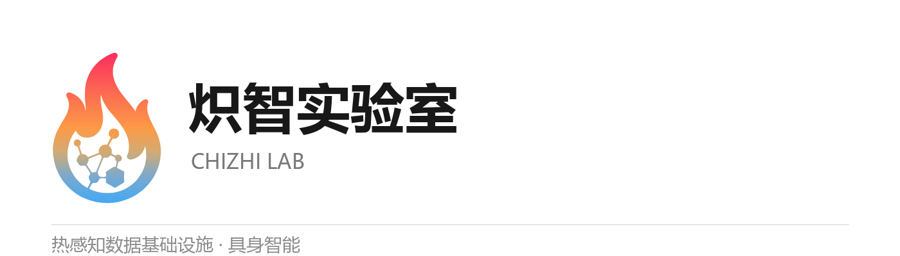
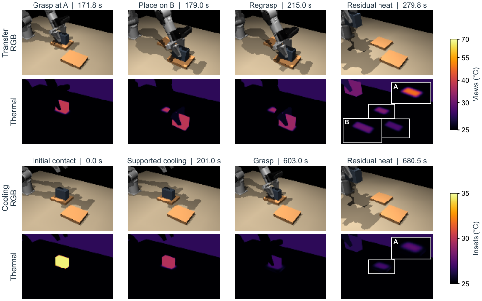

<div align="center" class="hero">
  <h1>TRR</h1>
  <p class="hero-subtitle">Thermal interaction simulation and RGBT data generation for robots.</p>
  <p class="hero-logos">
    
    
  </p>
  <p class="hero-affiliation"><strong>Chizhi Lab · Beijing Institute of Technology</strong></p>
  <p class="hero-hook">Giving robots a memory of contact heat.</p>
  <p class="hero-nav">
    <a href="#what-trr-does">Overview</a> ·
    <a href="#see-thermal-history-in-motion">Demonstration</a> ·
    <a href="#research-highlights">Results</a> ·
    <a href="#resources">Resources</a>
  </p>
</div>

## From one contact to the next

<p class="lead">Contact leaves heat behind. TRR carries that history into the next interaction.</p>

Earlier actions change the temperature of the object, gripper and supports. After the object leaves, those traces remain; subsequent contacts encounter the accumulated thermal history rather than a reset scene.

<figure class="figure">
  
  <figcaption><strong>Look at the boxed insets A and B in the final frames:</strong> they reveal residual heat left by earlier contacts. RGB and thermal rows show the same executions.</figcaption>
</figure>

## See thermal history in motion

<p class="demo-guide"><strong>Watch the thermal views:</strong> heat remains at the first support after transfer, then shapes what the robot encounters at the next contact.</p>

<figure class="figure">
  
  <figcaption>RGB, thermal views and temperature traces follow one execution: a robot waits for a hot object to cool, transfers it between supports and reveals earlier contact traces. <span class="caption-detail">Accelerated engineering demonstration; simulation time is shown on screen.</span></figcaption>
</figure>

## What TRR does

TRR connects robot motion, evolving material temperature and synchronized RGB–thermal observations. Its three central capabilities are:

<div class="card-grid">
  <div class="info-card">
    <h3>Persistent thermal memory</h3>
    <p>Contact traces stay on objects and grippers after separation.</p>
    <p class="card-detail">Surface patterns and internal heat storage move with the material.</p>
  </div>
  <div class="info-card">
    <h3>Contact-driven evolution</h3>
    <p>Every contact can change what happens next.</p>
    <p class="card-detail">Heating, cooling, transfer, separation and recontact evolve within one robot execution.</p>
  </div>
  <div class="info-card">
    <h3>Task-grounded observations</h3>
    <p>RGBT data stay synchronized with robot states, actions and task outcomes.</p>
    <p class="card-detail">Object, contact-region, timing and mechanical checks produce pass, fail or unresolved records.</p>
  </div>
</div>

Reusable scene resources include thermal assets, camera calibration and observation adapters for MuJoCo and Isaac Sim.

## Benchmark at a glance

<p class="section-intro">The paired benchmark repeats identical robot motions with fixed and evolving thermal fields.</p>

<div class="stats-grid" aria-label="TRR benchmark scale">
  <div class="stat"><span class="stat-number">4,448</span><span class="stat-label">trajectories</span></div>
  <div class="stat"><span class="stat-number">2,224</span><span class="stat-label">condition pairs</span></div>
  <div class="stat"><span class="stat-number">6</span><span class="stat-label">tasks</span></div>
</div>

<p class="caption">Each condition pair contains one static-field and one dynamic-field trajectory: 2,224 of each.</p>

## How TRR works

<div class="card-grid module-grid">
  <div class="info-card">
    <h3>How does the robot interact?</h3>
    <p>Concurrent and sequential contacts, including separation and recontact.</p>
  </div>
  <div class="info-card">
    <h3>Where is heat stored?</h3>
    <p>Surface traces and depth-dependent internal heat.</p>
  </div>
  <div class="info-card">
    <h3>How does heat evolve?</h3>
    <p>Contact exchange, diffusion and ambient exchange.</p>
  </div>
  <div class="info-card">
    <h3>What does the thermal camera see?</h3>
    <p>Surface temperature → radiation → camera response → temperature image.</p>
    <p class="card-detail">Matte and reflective responses; temperature in °C and an 8-bit display mapping.</p>
  </div>
  <div class="info-card">
    <h3>Which robots are represented?</h3>
    <p>Franka Panda, xArm 7 and Piper assets.</p>
  </div>
  <div class="info-card">
    <h3>How are outcomes checked?</h3>
    <p>Object, region, timing and completion checks.</p>
    <p class="card-detail">Each task event is recorded as pass, fail or unresolved.</p>
  </div>
  <div class="info-card">
    <h3>What is recorded together?</h3>
    <p>RGB, thermal images, timestamped actions and robot states.</p>
  </div>
</div>

<details class="technical-details">
  <summary>View the full technical diagram</summary>
  
</details>

## RGBT observations across backends

<figure class="figure">
  
  <figcaption><strong>MuJoCo (Piper, left)</strong> and <strong>Isaac Sim (Franka, right)</strong>, with RGB insets. Temperature images share a display scale; gray regions have unavailable temperature samples. The dynamic interaction and learning studies below use MuJoCo-based workflows.</figcaption>
</figure>

## Research highlights

<p class="section-intro">The benchmark and the two learning studies use separate corpora. The transfer result measures simulated task completion with learned region selection and a shared feedback executor.</p>

<div class="result-list">
  <div class="result-card">
    <h3>Thermal history can change a task label</h3>
    <p><strong>444 motions</strong> that pass with a fixed thermal field become thermal violations when the field evolves.</p>
    <p class="card-detail">The validity of the same motion depends on its thermal history.</p>
  </div>
  <div class="result-card">
    <h3>Visible thermal history improves contact-site selection</h3>
    <p><strong>91.7% vs. 75.0% safe choices</strong> for full visible RGBT history versus a matched final-frame-repeat control.</p>
  </div>
  <div class="result-card">
    <h3>Dynamic thermal training transfers better</h3>
    <p><strong>+50 percentage points</strong> under a new heating procedure for dynamic versus static training, using region selection with a shared feedback executor.</p>
  </div>
</div>

## A developer's workflow

1. **Start with a robot scene:** geometry, objects, supports, motion and camera placement.
2. **Configure thermal assets:** materials, initial fields, contact parameters and camera response.
3. **Execute the interaction:** evolve the thermal state alongside robot motion and sample observations at configured times.
4. **Inspect and export:** use synchronized observations, states, action intervals and task events for demonstrations, data analysis and learning.

The engineering inventory includes ten robot configurations, sixteen thermal-cache categories and six demonstrated camera viewpoints. LeRobot and robomimic formats have small-batch loading checks. These counts describe their respective resources, as recorded in the October 2026 engineering inventory.

## Resources

<div class="resource-grid">
  <div class="resource-card">
    <h3>Project & media</h3>
    <ul>
      <li><a href="https://github.com/BeverYang/TRR-Thermal-Renderer-for-Robot">GitHub repository</a></li>
      <li><a href="https://github.com/BeverYang/TRR-Thermal-Renderer-for-Robot/tree/main/assets">Overview images and demonstration GIF</a></li>
    </ul>
  </div>
  <div class="resource-card">
    <h3>Paper</h3>
    <ul>
      <li><a href="https://arxiv.org/html/2611.20792v1">Read the preprint · arXiv:2611.20792</a></li>
      <li><a href="#citation">Citation</a></li>
    </ul>
  </div>
</div>

<p class="caption">This repository is the public presentation hub for TRR; its <code>assets/</code> directory contains the overview and demonstration media shown here.</p>

<p class="closing">TRR makes thermal history part of robot simulation: contact is no longer a one-off collision, but a temperature memory that later actions can read.</p>

## Team

**[Biwen Yang](https://orcid.org/0009-0009-7887-7906), Zhe Cao, Jin Zhang, Haoyang Sun, Zonglu Hu, Jintao Zhao, Zhehao Zhang, Kaizheng Chen, Chengyi Liu, Chengyu Wei, Siyuan Wu, [Ruiheng Zhang](https://orcid.org/0000-0002-5460-7196)**  
Chizhi Lab, Beijing Institute of Technology. Ruiheng Zhang is the corresponding author.

## Citation

```bibtex
@misc{yang_trr,
  title  = {TRR: A Thermal Interaction Engine for Robot Simulation and RGBT Data Generation},
  author = {Yang, Biwen and Cao, Zhe and Zhang, Jin and Sun, Haoyang and Hu, Zonglu and Zhao, Jintao and Zhang, Zhehao and Chen, Kaizheng and Liu, Chengyi and Wei, Chengyu and Wu, Siyuan and Zhang, Ruiheng},
  year   = {2026},
  url    = {https://github.com/BeverYang/TRR-Thermal-Renderer-for-Robot},
  note   = {Preprint: \url{https://arxiv.org/html/2611.20792v1}}
}
```

Preview media retain their authors' copyright.
