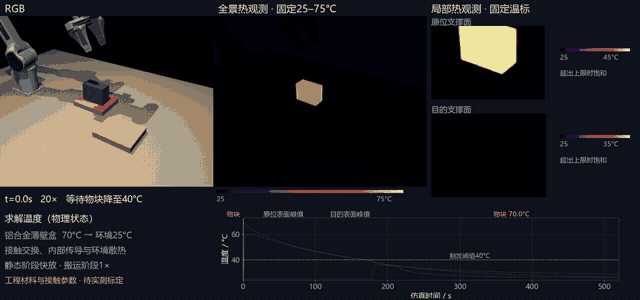
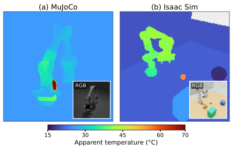

<div align="center" markdown="1">

# TRR
### A Thermal Interaction Engine for Robot Simulation and RGBT Data Generation

**A thermal interaction engine for robot simulation**

Contact leaves heat behind. TRR carries that history into the next interaction.

**Chizhi Lab · Beijing Institute of Technology**

[Overview](#what-trr-does) · [Demonstrations](#thermal-history-in-motion) · [Results](#research-highlights) · [Resources](#resources)

</div>

## Thermal history in motion



A robot waits for a hot object to cool, transfers it between supports, and reveals the heat left at the previous contacts. The RGB view, thermal views and temperature traces follow the same execution. This engineering demonstration uses accelerated playback; its simulation time is shown on screen.

## What TRR does

TRR connects robot interaction, evolving material temperature and RGB–thermal observations. Local heat exchange changes both contact partners. The resulting state moves with the material, spreads through it and persists after separation, shaping what the robot sees and what happens at the next contact.

- **Persistent thermal state:** local surface patterns and internal heat storage on both contact partners.
- **Contact-driven evolution:** heating, cooling, transfer, separation and recontact within a robot execution.
- **Synchronized observations:** RGB, thermal camera outputs, robot states and timestamped actions.
- **Task-grounded records:** object, contact-region, timing and mechanical checks with pass, fail or unresolved outcomes.
- **Reusable scene resources:** thermal assets, camera calibration and observation adapters for MuJoCo and Isaac Sim.


## From one contact to the next


The thermal traces remain after the object leaves. Earlier actions change the temperature of the object, gripper and supports; subsequent contacts encounter that accumulated history. These sequences illustrate the connection between physical interaction and the observations recorded for learning.

## RGBT observations across backends



**MuJoCo (Piper, left)** and **Isaac Sim (Franka, right)** observation examples. Insets show the corresponding RGB views. Temperature images share a display scale; gray regions have unavailable temperature samples. The dynamic interaction and learning studies reported below use MuJoCo-based workflows.

## Research highlights

| Study | Reported result | What it examines |
| :--- | :--- | :--- |
| Paired thermal benchmark | **2,224 condition pairs · 4,448 trajectories · 6 tasks** | Identical robot motions with fixed versus evolving thermal fields |
| Task validity | **444 fixed-field passes become thermal violations** | How thermal evolution changes the label of the same motion |
| Contact-site selection | **91.7% vs. 75.0% safe choices** | Full visible RGBT history versus a matched final-frame-repeat control |
| Simulated transfer | **+50 percentage points** under a new heating procedure | Dynamic versus static training for region selection with a shared feedback executor |

The benchmark and the two learning studies are separate corpora. The transfer comparison measures simulated task completion through learned region selection and common feedback execution.

## A developer's workflow

1. **Start with a robot scene:** geometry, objects, supports, motion and camera placement.
2. **Configure thermal assets:** materials, initial fields, contact parameters and camera response.
3. **Execute the interaction:** evolve the thermal state alongside robot motion and sample observations at configured times.
4. **Inspect and export:** use synchronized observations, states, action intervals and task events for demonstrations, data analysis and learning.

The engineering inventory includes ten robot configurations, sixteen thermal-cache categories and six demonstrated camera viewpoints. LeRobot and robomimic formats have small-batch loading checks. These counts describe their respective resources, as recorded in the October 2026 engineering inventory.

## Resources

This repository is the public presentation hub for TRR. The initial release contains the overview and demonstration media in [`assets/`](assets/). The [project page](https://beveryang.github.io/TRR-Thermal-Renderer-for-Robot/) presents TRR and its demonstrations.

| Resource | Status |
| :--- | :--- |
| Overview images and demonstration GIF | Available in this repository |
| Project website | [Visit the project page](https://beveryang.github.io/TRR-Thermal-Renderer-for-Robot/) |
| Public preprint | [arXiv:2611.20792](https://arxiv.org/html/2611.20792v1) |

## Team

**[Biwen Yang](https://orcid.org/0009-0009-7887-7906), Zhe Cao, Jin Zhang, Haoyang Sun, Zonglu Hu, Jintao Zhao, Zhehao Zhang, Kaizheng Chen, Chengyi Liu, Chengyu Wei, Siyuan Wu, [Ruiheng Zhang](https://orcid.org/0000-0002-5460-7196)**  
Chizhi Lab, Beijing Institute of Technology. Ruiheng Zhang is the corresponding author.

## Citation

```bibtex
@misc{yang_trr,
  title  = {TRR: A Thermal Interaction Engine for Robot Simulation and RGBT Data Generation},
  author = {Yang, Biwen and Cao, Zhe and Zhang, Jin and Sun, Haoyang and Hu, Zonglu and Zhao, Jintao and Zhang, Zhehao and Chen, Kaizheng and Liu, Chengyi and Wei, Chengyu and Wu, Siyuan and Zhang, Ruiheng},
  year   = {2026},
  url    = {https://github.com/BeverYang/TRR-Thermal-Renderer-for-Robot},
  note   = {Preprint: \url{https://arxiv.org/html/2611.20792v1}}
}
```

Code and dataset licensing will be specified with their respective releases. The preview media retain their authors' copyright.
